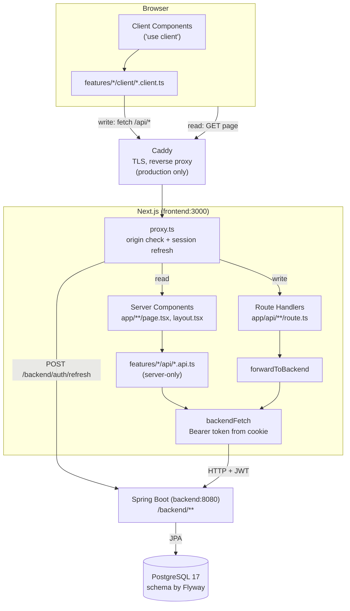
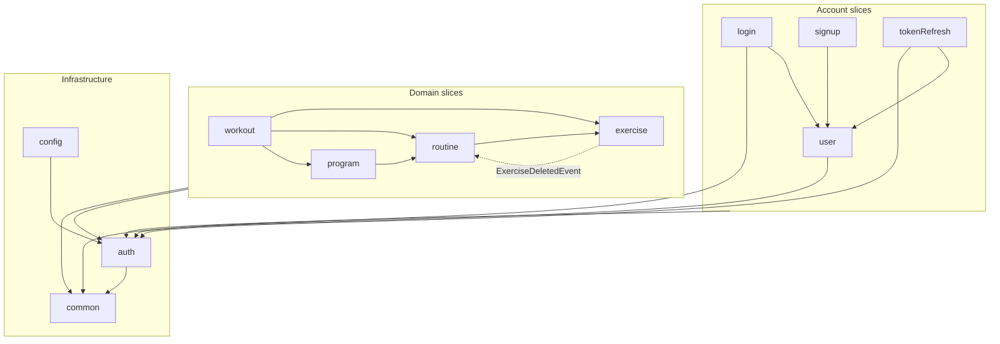
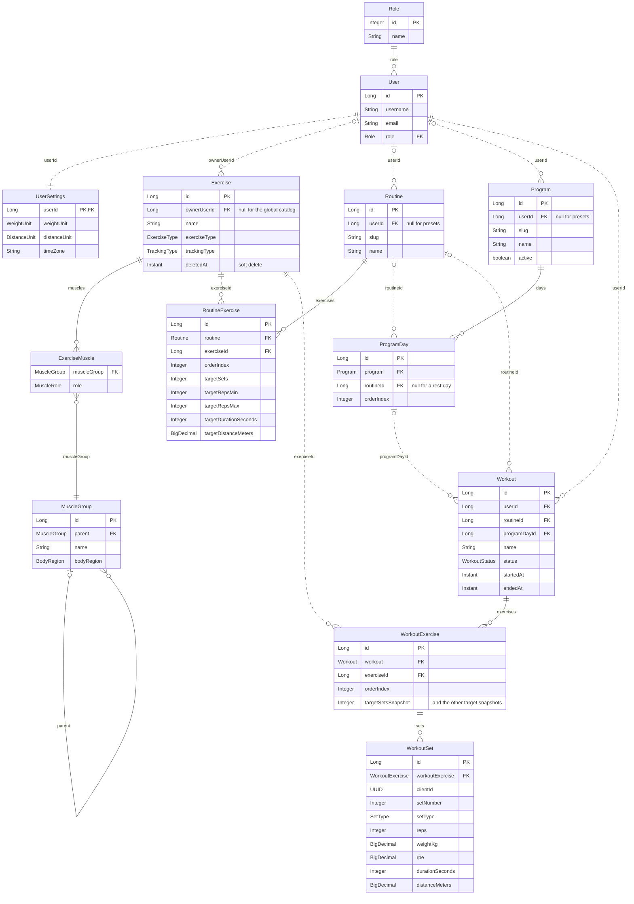

# Architecture

Three views of the application, derived from the code as of November 2026. The backend
slice rules are enforced by
[ArchitectureTests](../backend/src/test/java/de/phil/fitness/backend/architecture/ArchitectureTests.java)
(part of `mvnw verify`), the frontend import rules by
[dependency-cruiser](../frontend/.dependency-cruiser.cjs) (`npm run depcruise`, part of CI).

## System

The browser never talks to Spring directly: Caddy forwards everything to Next.js, the tokens sit in
httpOnly cookies that only the Next.js server reads, and only that server calls the backend inside
the compose network. Every request except static assets first passes `proxy.ts`, which rejects
cross-origin writes to `/api/*` and renews a missing or expiring access token against
`/backend/auth/refresh`. Reads happen while rendering,
through the server-only `*.api.ts` modules, while writes start in a client component, go through a
`*.client.ts` function to a route handler under `/api/*`, and reach Spring via `forwardToBackend`.

## Backend slices

Each package under `de.phil.fitness.backend` is a slice, and a solid arrow means that classes of
one slice import classes of the other (an arrow from a group stands for every slice in it). The
domain slices only depend downwards, so `exercise` knows
none of the others: when an exercise is deleted it publishes an `ExerciseDeletedEvent`, and the
routine slice listens to it and removes the exercise from its routines (the dotted arrow is that
runtime flow, the import still points from routine to exercise). The tests check that there are no
cycles between slices, that the domain direction holds and that `common` depends on no other slice.

## Domain model

The JPA entities live in the `model` package of their slice, and `ExerciseMuscle` is an
`@Embeddable` stored in `EXERCISE_MUSCLEGROUP`. Solid lines are JPA references, which only exist
inside a slice; dashed lines are plain id columns, so slices refer to each other's rows by id only
(the foreign keys exist in the schema, not in the entities). Timestamps are left out. Preset
routines and programs have `userId` null, and users work with their own copies of them.
